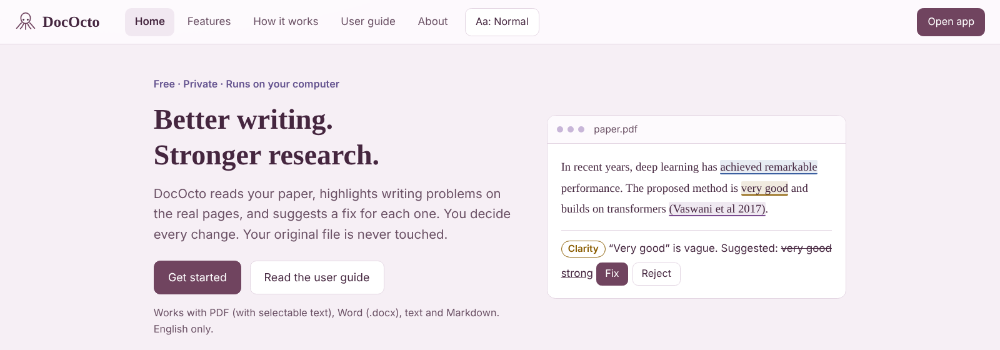
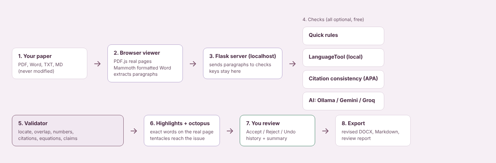
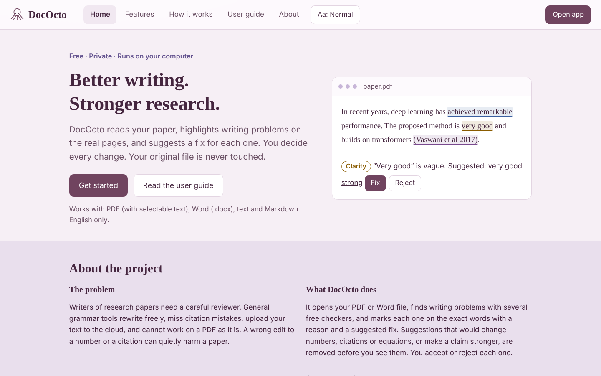
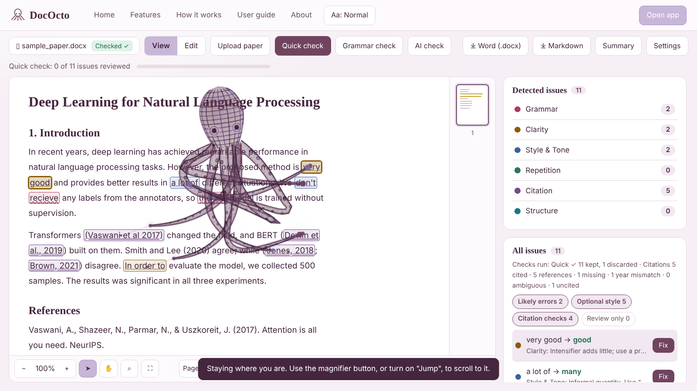
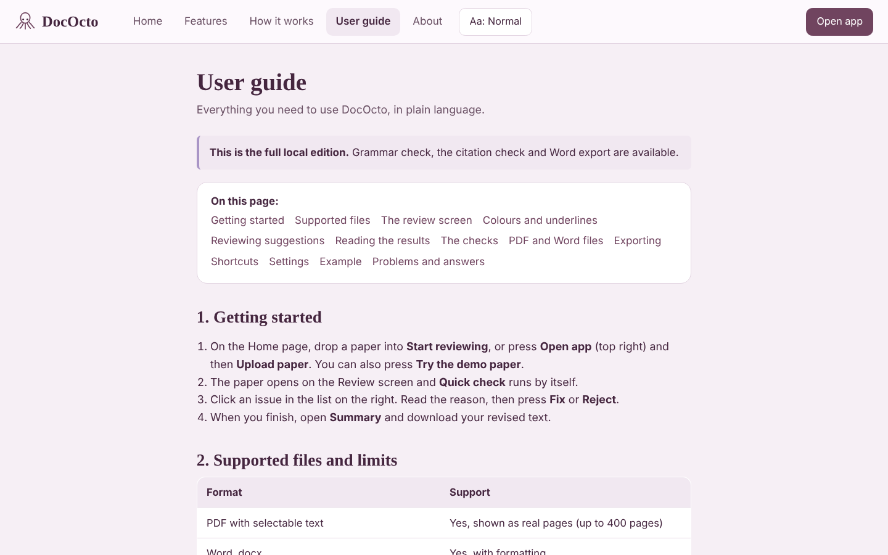
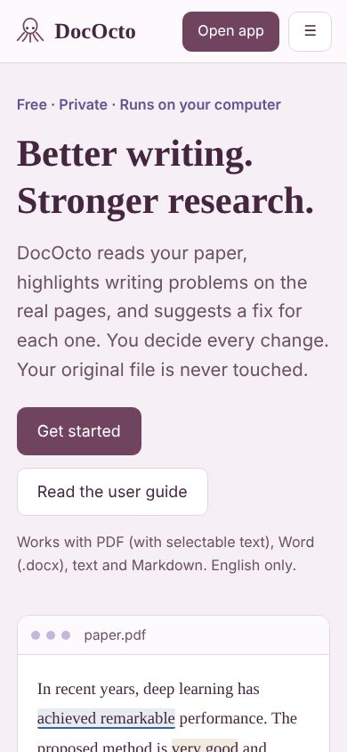

<p align="center">
  
</p>

<h1 align="center">DocOcto</h1>
<p align="center">A free, local-first writing reviewer for research papers, with an octopus that points at the problems.</p>
<p align="center">
  
  
  
  
</p>
<p align="center"><em>Runs on your own computer (no hosted demo). See Installation.</em></p>

## 1. Overview
DocOcto reads a research paper (PDF or Word), highlights writing problems on the real pages, explains each one and suggests a fix. You accept or reject every change. An animated wireframe octopus points at the issues. Everything runs locally and uses free tools.

## 2. Problem Statement
Academic writers need a reviewer that respects their meaning. General grammar tools rewrite freely, miss citation problems, send text to the cloud, and cannot work on a PDF as it is. Wrong edits to numbers or citations can quietly damage a paper.

## 3. Proposed Solution
Several free checkers (rules, LanguageTool, local or free AI, APA citation consistency) feed one validator that rejects any suggestion that changes numbers, citations or equations or strengthens a claim. You review each remaining suggestion on the real document, and your original file is never modified.

## 4. Key Features
- Real PDF pages and formatted Word files, with issues marked on the exact words
- Four checks: rules, grammar (LanguageTool), AI (Ollama, Gemini or Groq), APA citation consistency
- Code-enforced safety checks on every suggestion, with a reason shown for each
- Accept, reject, undo, change history, review summary, and DOCX or Markdown export
- Private by default: cloud AI is optional and asks first
- Easy to read: large text with a text-size button, a calm purple palette, keyboard shortcuts, reduced-motion support, and an octopus that never blocks reading

## 5. System Architecture

*The page extracts paragraphs, the local server runs the checks, one validator filters every suggestion, and you decide what changes.*

## 6. Technology Stack
| Area | Tools |
|------|-------|
| Languages | Python, JavaScript |
| Backend | Flask, python-docx, pypdf |
| Front end | HTML, CSS, Canvas 2D, PDF.js, Mammoth |
| Language checks | LanguageTool, Ollama, Gemini, Groq (all optional) |
| Testing | pytest, Playwright (Chromium) |
| Evaluation data | 41 labelled paragraphs (see Results) |

## 7. How It Works
1. You upload a PDF or Word file. It is shown as real pages or with its formatting.
2. The page extracts paragraphs and the server runs the checks (Quick check starts by itself).
3. Every suggestion goes through the validator (locatable, no overlap, no changed numbers, citations or equations, no stronger claims).
4. Safe suggestions are drawn on the exact words and the octopus reaches for them.
5. You press Fix or Reject, and can undo. Changes go to a revised text and a history.
6. You export the revised text or a review report. The original file stays untouched.

## 8. Screenshots / Demo

*The home page: top navigation, an explanation of the project, features, how it works and an upload area. No sidebar.*


*The review screen: issues highlighted in a light, large-text layout, each with a reason and a Fix button.*


*The built-in user guide with supported files, limits and how to read the results.*


*The same site on a phone-sized screen.*

*Captured from the running app on a short sample document (not a real thesis). The PDF page view is not shown because it needs PDF.js, which could not be loaded in the capture environment.*

## 9. Installation & Setup
```bash
git clone https://github.com/your-username/dococto.git   # replace with your repository URL
cd dococto
sudo apt update && sudo apt install -y python3 python3-venv python3-pip
bash run.sh        # creates .venv, installs dependencies, starts the server
```
Optional extras (grammar check, AI check) are in [docs/FEATURES_AND_USAGE.md](docs/FEATURES_AND_USAGE.md).

## 10. Usage
```bash
bash run.sh                                   # then open http://localhost:3000 and upload a paper
python -m pytest -q                           # run the tests (pip install -r requirements-dev.txt first)
python eval/run_eval.py --systems rules       # score the built-in rules on the labelled set
```

## 11. Results & Evaluation
| System | Precision | Recall | F1 |
|--------|-----------|--------|----|
| Built-in rules (strict span match) | 82% | 51% | 63% |

- 41 paragraphs, 35 labelled issues. The labels were written by an AI assistant, not independent humans, so treat this as a seed set. LanguageTool and AI are not scored yet.
- 111 automated tests pass in the build environment, including 28 in a real browser.

## 12. Project Structure
```
dococto/
├── app.py                 # server and API
├── dococto/               # validation, rules, citations, export, metrics
├── public/index.html      # the whole front end
├── eval/                  # labelled dataset and evaluation runner
├── tests/                 # unit, API and real-browser tests
├── docs/                  # full documentation, progress, portfolio text
├── assets/                # banner, architecture diagram, screenshots
├── scripts/               # one-time download of PDF.js and Mammoth
├── run.sh                 # one-command start
└── requirements*.txt
```

## 13. Limitations
- Less accurate than commercial tools: the rules find about half of the labelled problems and few grammar-agreement errors.
- A PDF cannot be edited in place; fixes go to a separate revised text. Scanned PDFs need OCR first. English only.
- Citation check covers APA author-year only and never verifies that a source exists.
- The front end is one large file, and the real PDF.js and Word viewers are not covered by automated tests.

## 14. Future Improvements
- Score LanguageTool and AI on the labelled set after a human review of the labels
- OCR for scanned PDFs and support for numbered citation styles
- Split the front end into modules
- Saved review sessions and a custom vocabulary screen

## 15. Contributors
- [Your Name](https://github.com/your-username): replace with your name and your role (for example, product owner and tester)
- Implementation was produced with an AI coding assistant (Claude).

## 16. License
No license has been chosen yet. Add a `LICENSE` file before publishing (for example MIT).

---
More detail: [full documentation](docs/FEATURES_AND_USAGE.md) · [status and test checklist](docs/PROGRESS.md) · [portfolio text](docs/PORTFOLIO_SHOWCASE.md)

## Customising the footer
The footer shows a GitHub link and a contributors line only when you fill them in. Open `public/index.html`, find `const REPO_URL='',OWNER_NAME='';` and set your repository address and name.
