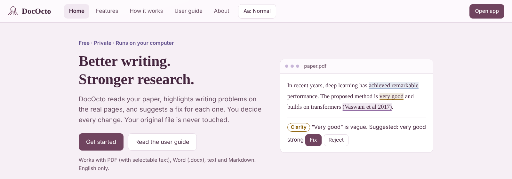
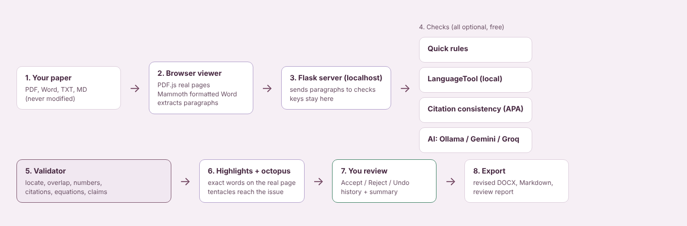
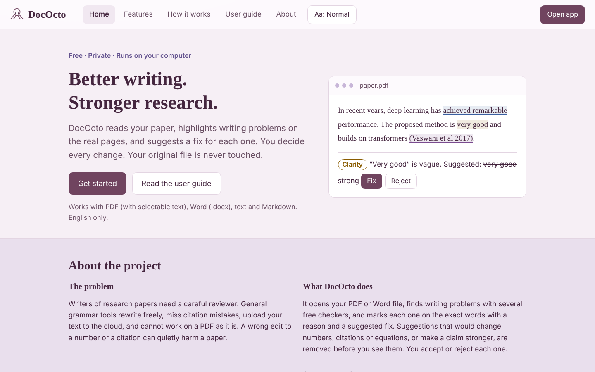
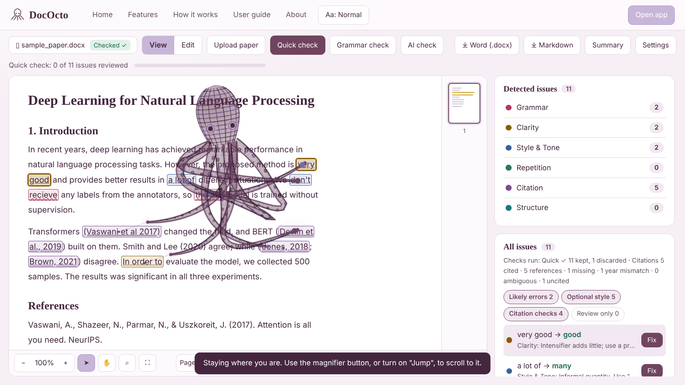
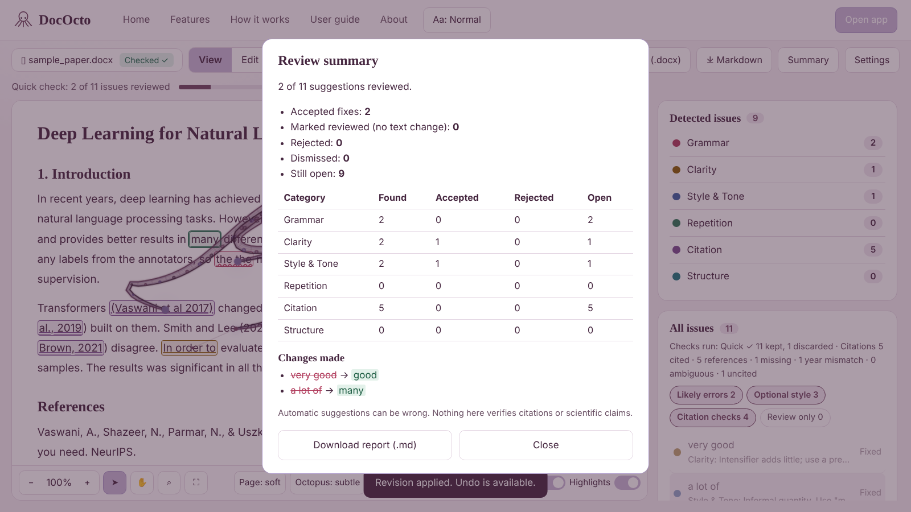

# DocOcto
`Web App` `In Progress`

**Summary:** Academic writers need a reviewer that respects their meaning, but general tools rewrite freely and send text to the cloud. DocOcto highlights writing problems on the real PDF or Word pages, suggests fixes that code has checked for safety, and lets the author approve every change, all on their own computer.

**Key Features**
- Real PDF pages and formatted Word files with issues marked on the exact words
- Four free checks: rules, LanguageTool grammar, local or free AI, APA citation consistency
- Every suggestion is validated in code: no changed numbers, citations or equations, no stronger claims
- Accept, reject, undo, history, summary and Word export; an animated octopus guides the review

**Tech Stack:** Python · Flask · JavaScript · Canvas · PDF.js · LanguageTool · pytest · Playwright

**Results:** 82% precision and 51% recall for the built-in rules on a 41-paragraph labelled set (labels written by an AI assistant; not independently verified); 111 automated tests pass.

**Links:** [GitHub](https://github.com/your-username/dococto) (replace) | Live Demo: none, runs locally | [View Details](#view-details)

---

## View Details

### Overview
Peer-reviewed writing depends on precise numbers, citations and claims. DocOcto is a local-first review tool built around one rule: automatic suggestions may help, but only the author decides what changes. It reads PDF and Word papers, shows them as they are, and marks issues on the exact words. A procedural wireframe octopus points at the problems. The goal was a free, private tool that is honest about what it cannot do.

### Problem Statement
General grammar tools rewrite freely, miss citation inconsistencies, upload text to the cloud and cannot work on a PDF as it is. A wrong edit to a number or a citation can quietly harm a research paper.

### Proposed Solution
Several free checkers feed one validator that rejects suggestions that change numbers, citations or equations, or strengthen a claim. The author reviews each remaining suggestion on the real document, with undo and a change history, and the original file is never modified.

### Architecture

*Paragraphs go to a local server, four optional checks run, one validator filters the results, and the author decides.*

### Screenshots

*The home page explains the app at first glance, with no sidebar.*

*The review screen: highlighted issues in a light, large-text layout, each with a reason and a Fix button.*

*The review summary lists what was accepted, rejected and left open.*

### My Contribution
*Edit this to match what you actually did.* Defined the product idea and requirements, directed each iteration, tested the app on real papers and reported the problems that shaped later versions. The code was written with an AI coding assistant (Claude); be ready to explain the design decisions and how the tests and evaluation work.

### Challenges & Learnings
- **Real PDFs are messy:** headings, tables and running headers merged into long "sentences" and produced false flags. Fixed by removing repeated headers and footers, skipping non-prose text and adding a prose test.
- **Testing found real bugs:** the evaluation showed the validator rejecting a harmless citation comma fix as an invented citation, and real use showed zoom jumping to the top and the page scrolling by itself. Each fix got a regression test.
- **Trust needs code, not prompts:** asking an AI not to change numbers is not enough, so a validator enforces it and reports what it discarded.

### Detailed Results
| System | Precision | Recall | F1 | Notes |
|--------|-----------|--------|----|-------|
| Built-in rules | 82% | 51% | 63% | 41 paragraphs, 35 labelled issues; strict span match |

Recall by issue type: citations, style and structure 100%, clarity 71%, repetition 50%, grammar 12%. The labels were written by an AI assistant and the set partly matches what the rules were built to find, so real papers will score lower. LanguageTool and AI are not scored yet. 111 automated tests pass in the build environment (28 in a real browser).

### Future Improvements
Score LanguageTool and AI after a human review of the labels; add OCR for scanned PDFs and numbered citation styles; split the front end into modules.
